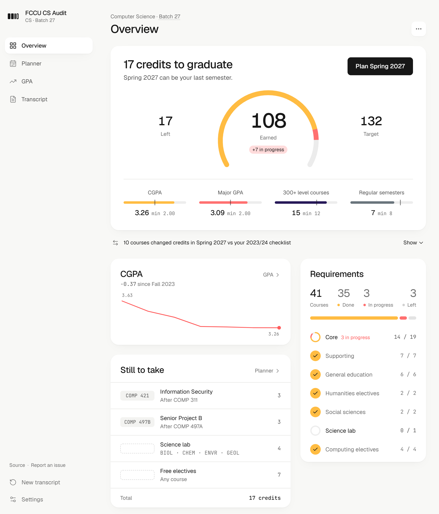
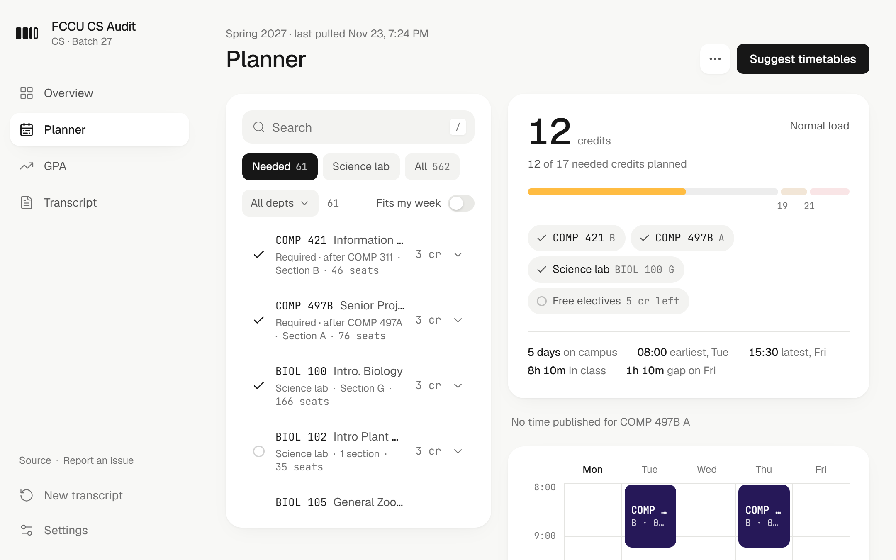
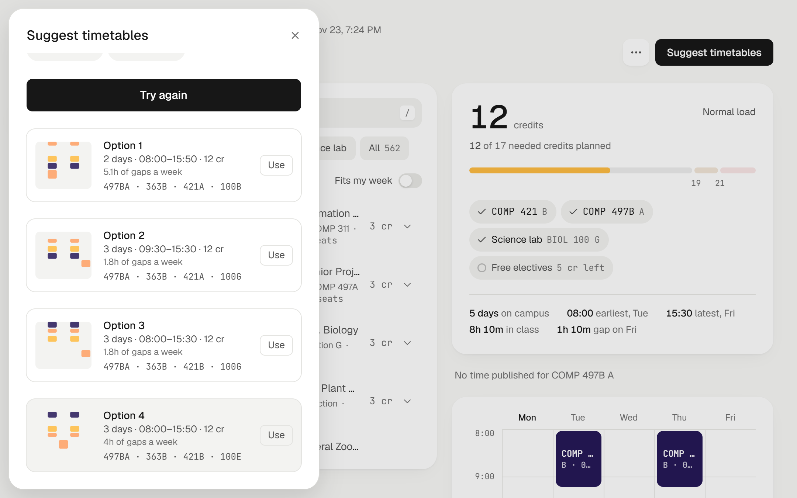
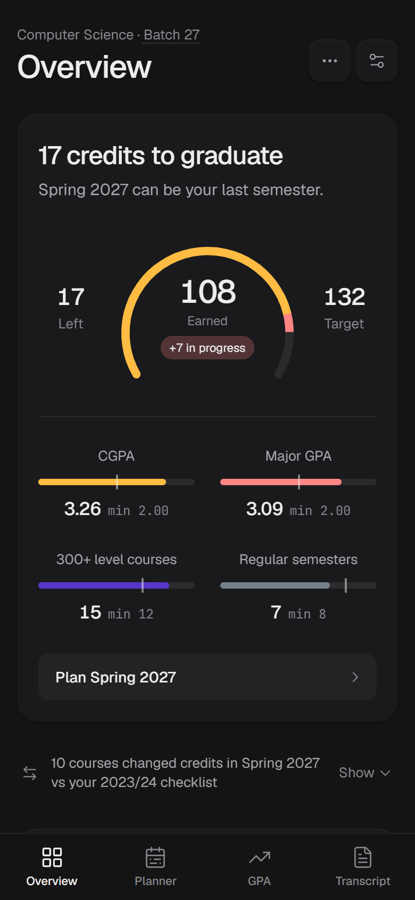
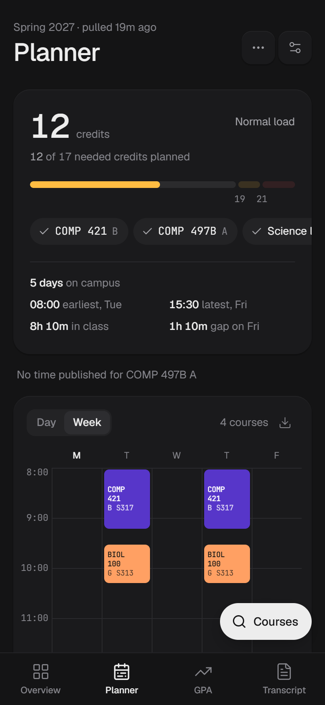
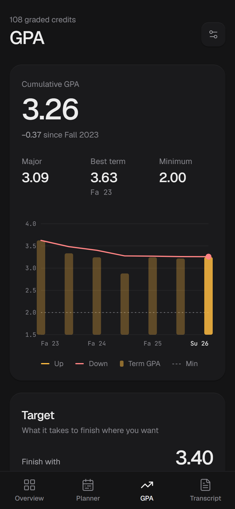

# FCCU CS Audit

Degree audit and timetable planner for BS Computer Science at FCCU.

**[csaudit.vercel.app](https://csaudit.vercel.app)**

Paste your unofficial transcript from Empower (or drop the PDF) and it shows what you've completed and what's left. Then build a clash free timetable from the courses currently being offered.

Everything runs in the browser. The transcript is never uploaded, and it's forgotten when you close the tab.



## What it does

- **Overview**: credits earned and left, CGPA and major GPA against their minimums, and every requirement checked against your batch's checklist.
- **Planner**: search every section offered next term, see clashes as you pick, and check your credit load.
- **Suggested timetables**: set your start and finish times and days off. Keep sections you like, mark courses you'd only take if they fit, and pick a credit range. If nothing fits, it tells you why.
- **Share and export**: send a timetable as a link, add it to your calendar (.ics), or save it as an image.
- **GPA**: term-by-term history, the grades you'd need for a target CGPA, and what retakes would do.
- **Transcript**: every course it read, checked against the transcript's own totals, and editable.





<p align="center">
  
  
  
</p>

## Running it

```sh
npm install
npm run dev
npm test
```

## Data

| What | Where |
| --- | --- |
| Degree checklist per batch | `src/data/programs/` |
| Course titles, credits and prerequisites per catalog year | `src/data/courses/` |
| Section list per term | `src/data/terms/` |
| Official PDFs | `public/docs/` |

Section lists come from FCCU's public course catalog. A GitHub Action (`.github/workflows/catalog.yml`) checks for changes every 3 hours (current site does it every hour) and commits when something changed. To run it locally:

```sh
pip install requests beautifulsoup4
python scripts/scrape.py           # newest term
python scripts/scrape.py 2027FA    # a specific term
```

To add a batch, copy the closest file in `src/data/programs/`, update it and register it in `src/data/registry.ts`. `npm test` checks it against the catalog.

## Contributing

Found something wrong for your batch? [Open an issue](https://github.com/qs-1/csaudit/issues/new). See [CONTRIBUTING.md](CONTRIBUTING.md) for the rest.

## License

[MIT](LICENSE)
